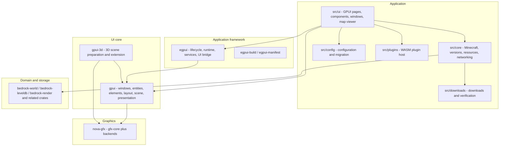

# Architecture

This document describes the stable layering, crate responsibilities and dependency direction of the
BMCBL workspace. Code and rustdoc are authoritative for implementation details; cross-layer changes
must update this document or add an ADR.

## 1. Layers



## 2. Dependency direction (hard rules)

```text
BMCBL app (src/)
  -> egpui, gpui, gpui-3d, bedrock-*, bmcbl-plugin-api, nethernet, easytier-bmcbl
egpui -> gpui
gpui-3d -> gpui + gfx-core
gpui -> gfx-core + selected gfx-<backend>
gfx-<backend> -> gfx-core (+ gfx-memory / gfx-shader)
```

- **No reverse dependencies.** `nova-gfx`/`gfx-*` must not depend on `gpui`, `egpui`, the
  application or any UI concept. `gpui` must not depend on BMCBL application code.
- **Windowing stays at the edge.** `gfx-core` has no `winit`/`raw-window-handle` dependency;
  each backend defines native targets through `SurfaceDevice::SurfaceTarget`.
- **The framework owns no product logic.** `egpui` provides lifecycle, runtime, UI bridges, i18n
  and durable-task abstractions; downloads, worlds and maps remain in `src/`.
- **Domain crates stay free of UI/GPU policy.** `bedrock-*` handles Bedrock data and CPU
  rendering without depending on `gpui`.

See [ADR 0001](adr/0001-nova-gfx-gpui-boundary.md) for the boundary decision.

## 3. Crate responsibilities

| Crate | Responsibility | Constraint |
| --- | --- | --- |
| `gpui` | Windows, entity state, declarative elements, layout, input, text, scene, presentation | Generic UI core; no BMCBL business logic |
| `gpui-3d` | 3D scenes, cameras, materials, animation, queries, glTF, offscreen and scene views | Scene preparation and extension resources only; presentation belongs to gpui/nova |
| `gpui_tokio` | GPUI/Tokio task integration | No runtime handles in UI state |
| `gpui-hooks` / `gpui-hooks-macros` | Hooks and their macros | UI state reuse only |
| `gpui-macros` | Procedural-macro mirror for GPUI | Keep behaviour aligned with upstream macros |
| `lucide-gpui` | Lucide icon assets for GPUI | Icons generated at build time |
| `egpui` | Desktop host, Tokio/Rayon runtime, task scopes, UI bridges, i18n, durable tasks | No routes, downloads, maps or product policy |
| `egpui-build` / `egpui-manifest` | Manifest validation, resource indexing, platform bundle plans | Build-time contracts only |
| `nova-gfx` family | Backend-neutral graphics API and backends | Pure graphics library; see [CRATES](CRATES.md) |
| `bedrock-world` | Bedrock world, level.dat, NBT, players, chunks, versions | Owns Bedrock world semantics |
| `bedrock-leveldb` | Modified LevelDB storage engine | Storage mechanics only |
| `bedrock-render` | CPU tile rendering for worlds | No gpui dependency |
| `bedrock-block-model` | Resource-pack block model resolution | Produces model descriptions only |
| `bedrock-brarchive` | Read-only BRArchive v1 access | No extraction or decoding |
| `bedrock-voxel` | Image/OBJ to block placement plans | Does not write worlds |
| `bmcbl-plugin-api` / `-macros` | WASM plugin ABI, macros, `.bmcblx` packing | API version `0.6`, manifest schema `2` |
| `nethernet` | Bedrock NetherNet (WebRTC) transport | Protocol layer only |

See [CRATES](CRATES.en.md) for the full catalog, status and boundaries.

## 4. Rendering stack

1. **gpui** turns layout/paint into an immutable `Scene` and a `PresentationPacket`; retained
   repaint, damage merging and partial-present policy belong to gpui.
2. **The gpui nova renderer** encodes the scene into `FrameUpload`, `RenderCommand` lists and
   `RenderPassCommands`; it owns atlases, blur, path masks, retained resources and submission
   tracking.
3. **nova-gfx** provides device/resource/pipeline/command/swapchain/surface primitives. Canonical
   entry points:
   - `PresentationDevice::render_and_present(&PresentFrameDescriptor)`
   - `PresentationDevice::render_to_textures(&[RenderPassCommands])`
   - `SurfaceDevice::{resize_swapchain, recreate_swapchain, swapchain_extent, resolve_composite_alpha}`
4. **Backends** implement the traits for DX11/DX12/Vulkan/OpenGL/Metal/WebGL. `gfx-core` is the
   UI-free, window-handle-free public contract.

Frame flow: platform input → gpui state update → element tree render/prepaint/paint → `Scene` +
`PresentationPacket` → nova encoding → gfx commands/offscreen passes → acquire/submit/present →
frame-ready callback or deferred submission tracking.

`present_region` is the graphics-level changed-area argument; `DirtyRegion`/damage merging belongs
to gpui.

## 5. Backend selection

- Windows default build: DX11 (target dependency) + DX12 + Vulkan + OpenGL; the application
  default backend is `dx11` and can be changed in settings.
- Linux: Vulkan (default) + OpenGL 4.5; Wayland/X11 is selected by the gpui platform layer.
- macOS: not supported by the application; gpui keeps Metal code as a target-platform
  implementation only.
- WebGL is a stub and `gfx-metal` still has unimplemented offscreen paths; see each crate README.

## 6. Runtime and threading

- **Foreground UI thread**: `gpui::App`/`Window`/renderer are owner-thread objects; GPU devices are
  not `Send`.
- **egpui runtime**: an application-owned Tokio runtime handles network/IO and a Rayon pool handles
  CPU-heavy work. `TaskScope` provides cancellation and terminal states; `UiHandle`,
  `UiStreamBridge` and `UiTaskBridge` coalesce results onto the GPUI foreground executor.
- **gpui_tokio**: adapts Tokio inside the GPUI task domain; never block the render path.
- **Plugins**: WASM plugins run sandboxed; host capabilities are exposed through
  capability/allowlist checks, and UI injection/events go through the plugin runtime instead of
  holding GPUI internals.

## 7. Application modules

| Path | Responsibility |
| --- | --- |
| `src/ui` | Pages, components, windows, theme; rendering and UI coordination only |
| `src/cli` | Terminal subcommands, output format and exit codes |
| `src/startup_args` | Program-startup arguments for shortcuts, file associations, the updater and legacy aliases |
| `src/core` | Minecraft/GDK, versions, accounts, CurseForge, maps, networking |
| `src/downloads` | Download tasks, concurrency, WU protocol, verification |
| `src/config` | Config structures, defaults, migration, persistence |
| `src/plugins` | Plugin loading, manifests, WASM sandbox, UI DSL, packing |
| `src/i18n` | Runtime localization |
| `src/tasks`, `src/utils`, `src/http`, `src/archive` | Supporting task, utility, HTTP and archive modules |
| `src/ui/window/map_viewer` | Map window: streaming tiles, chunk/record editing, structure import/export, 3D preview |
| `assets` | Build-time embedded resources and localization |

The map window streams visible tiles from the current viewport with cancellable generation,
decoding and caching; world writes require explicit confirmation and history capture.

## 8. Related documentation

- [BUILD_AND_TEST](BUILD_AND_TEST.en.md): build, features, test tiers
- [CONTRIBUTING](CONTRIBUTING.en.md): workflow and boundary checks
- [NAMING](NAMING.md): public/internal naming rules (Chinese)
- [CRATES](CRATES.en.md): crate catalog
- [ADR 0001](adr/0001-nova-gfx-gpui-boundary.md): nova-gfx / gpui boundary (Chinese)
