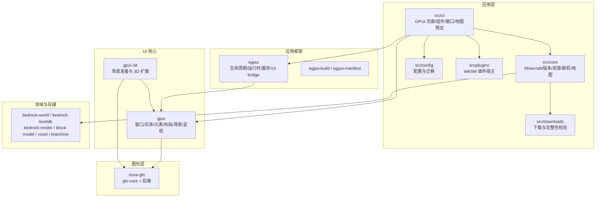

# 系统架构

本文描述 BMCBL 工作区的稳定分层、crate 职责和依赖方向。实现细节以代码和 rustdoc 为准；
跨层变更需要同步更新本文或新增 ADR。

## 1. 分层总览



## 2. 依赖方向（硬性规则）

```text
BMCBL app (src/)
  -> egpui, gpui, gpui-3d, bedrock-*, bmcbl-plugin-api, nethernet, easytier-bmcbl
egpui -> gpui
gpui-3d -> gpui + gfx-core
gpui -> gfx-core + 所选 gfx-<backend>
gfx-<backend> -> gfx-core (+ gfx-memory / gfx-shader)
```

- **禁止反向依赖**：`nova-gfx`/`gfx-*` 不得依赖 `gpui`、`egpui`、应用代码或任何 UI 概念；
  `gpui` 不得依赖 BMCBL 应用层。
- **窗口系统隔离**：`gfx-core` 不依赖 `winit`/`raw-window-handle`；native surface 由各 backend
  的 `SurfaceDevice::SurfaceTarget` 定义。
- **应用框架不拥有业务**：`egpui` 只提供生命周期、运行时、UI bridge、i18n 与持久任务抽象；
  下载/存档/地图等语义留在 `src/`。
- **领域 crate 不依赖 UI/GPU**：`bedrock-*` 负责 Bedrock 数据与 CPU 渲染，不依赖 `gpui`。

边界决策的完整背景见 [ADR 0001](adr/0001-nova-gfx-gpui-boundary.md)。

## 3. crate 职责

| crate | 职责 | 关键约束 |
| --- | --- | --- |
| `gpui` | 窗口、实体状态、声明式元素、布局、输入、文本、场景与呈现调度 | 通用 UI 核心，不含 BMCBL 业务；渲染后端通过 nova-gfx |
| `gpui-3d` | 3D 场景/相机/材质/动画/查询、glTF 导入、离屏渲染与 scene view | 只做 3D 场景准备与扩展资源；呈现与后端归 gpui/nova |
| `gpui_tokio` | GPUI 与 Tokio 任务集成 | 不把 Tokio 句柄泄漏进 UI 状态 |
| `gpui-hooks` / `gpui-hooks-macros` | GPUI hooks 与宏 | 只封装 UI 状态复用模式 |
| `gpui-macros` | GPUI 派生宏镜像 | 与上游宏保持行为一致 |
| `lucide-gpui` | Lucide 图标资产到 GPUI 的适配 | 构建期生成图标数据 |
| `egpui` | 桌面应用 host、Tokio/Rayon 运行时、任务 scope、UI bridge、i18n、持久任务 | 不包含路由、下载、地图等产品语义 |
| `egpui-build` / `egpui-manifest` | `App.toml`/manifest 校验、资源索引、平台打包计划 | 构建期契约，不执行打包工具 |
| `nova-gfx` 族 | 后端无关图形 API 与 DX11/DX12/Vulkan/OpenGL/Metal/WebGL 实现 | 纯图形库，详见 [CRATES](CRATES.md) |
| `bedrock-world` | Bedrock 世界/level.dat/NBT/玩家/区块读写与多版本语义 | 拥有 Bedrock 世界语义 |
| `bedrock-leveldb` | Mojang 修改版 LevelDB 存储引擎 | 只负责存储机制 |
| `bedrock-render` | 世界瓦片 CPU 渲染 | 不依赖 gpui |
| `bedrock-block-model` | 资源包方块模型解析 | 只产出模型描述 |
| `bedrock-brarchive` | BRArchive v1 只读访问 | 不负责解包/解码 |
| `bedrock-voxel` | 图片/OBJ → 方块放置计划 | 不直接写世界 |
| `bmcbl-plugin-api` / `-macros` | WASM 插件 ABI、宏与 `.bmcblx` 打包 | API 版本 `0.6`，manifest schema `2` |
| `nethernet` | Bedrock NetherNet（WebRTC）传输 | 协议层，不做 UI |

完整 crate 目录、状态与边界见 [CRATES](CRATES.md)。

## 4. 渲染栈

### 4.1 分层

1. **gpui**：布局/绘制生成不可变 `Scene`，按帧生成 `PresentationPacket`；保留模式重绘、
   damage 合并、部分呈现策略由 gpui 决定。
2. **gpui 的 nova 渲染器**：把场景编码为 `FrameUpload`、`RenderCommand` 列表与
   `RenderPassCommands`，管理 atlas、blur、path mask、retained 资源与提交跟踪。
3. **nova-gfx**：设备/资源/管线/命令/swapchain/surface 原语；backend 负责原生
   acquire/present 同步。核心入口：
   - `PresentationDevice::render_and_present(&PresentFrameDescriptor)`
   - `PresentationDevice::render_to_textures(&[RenderPassCommands])`
   - `SurfaceDevice::{resize_swapchain, recreate_swapchain, swapchain_extent, resolve_composite_alpha}`
4. **backend**：DX11/DX12/Vulkan/OpenGL/Metal/WebGL。`gfx-core` 是无 UI、无窗口句柄的公共契约。

### 4.2 帧流程（概念）

```text
platform input -> gpui window/entity update
  -> element tree render/prepaint/paint
  -> Scene + PresentationPacket
  -> nova renderer frame encoding
  -> gfx commands / offscreen passes
  -> acquire + submit + present (surface)
  -> frame-ready callback / deferred submission tracking
```

`present_region` 是图形边界的“变化区域”参数；`DirtyRegion`/damage 的合并策略属于 gpui。

### 4.3 后端选择

- Windows 默认构建：DX11（target 依赖）+ DX12 + Vulkan + OpenGL；应用默认后端 `dx11`，
  可在设置中切换。
- Linux：Vulkan（默认）+ OpenGL 4.5；Wayland/X11 由 gpui 平台层选择。
- macOS：应用不支持；gpui 的 Metal 代码仅作为目标平台实现维护。
- WebGL 后端为 stub，`gfx-metal` 的离屏路径仍有未实现能力，详见各 crate README。

## 5. 运行时与线程

- **前台 UI 线程**：`gpui::App`/`Window`/渲染器由 owner 线程持有；GPU 设备不是 `Send`。
- **egpui 运行时**：应用拥有的 Tokio runtime 处理网络/IO，Rayon 处理 CPU 密集任务；
  `TaskScope` 提供取消与终态；`UiHandle`/`UiStreamBridge`/`UiTaskBridge` 把后台结果
  合并后送回 GPUI 前台执行。
- **gpui_tokio**：在 GPUI 任务域中安全使用 Tokio 的适配层；禁止在 render 路径阻塞等待。
- **插件**：WASM 插件在沙箱中执行；host 能力通过 capability/allowlist 暴露，UI 注入和
  事件订阅走插件运行时，不直接持有 GPUI 内部句柄。

## 6. 应用层模块

| 路径 | 职责 |
| --- | --- |
| `src/ui` | 页面、组件、窗口、主题；只做渲染与 UI 协调 |
| `src/cli` | 终端命令行子命令、输出格式与退出码 |
| `src/startup_args` | 启动程序的参数：快捷方式、文件关联、更新器与兼容别名 |
| `src/core` | Minecraft/GDK/版本/账号/CurseForge/地图/联机等领域逻辑 |
| `src/downloads` | 下载任务、并发、WU 协议、校验 |
| `src/config` | 配置结构、默认值、迁移、持久化 |
| `src/plugins` | 插件加载、manifest、WASM 沙箱、UI DSL、打包 |
| `src/i18n` | 运行时多语言 |
| `src/tasks` / `src/utils` / `src/http` / `src/archive` | 任务、工具、HTTP、归档支撑 |
| `src/ui/window/map_viewer` | 地图窗口：瓦片流式渲染、区块/记录编辑、结构导入导出、3D 预览 |
| `assets` | 构建期嵌入资源与本地化 |

地图窗口的高层语义：可见瓦片按视口流式加载，缓存/解码/generation 可取消；世界写入必须
显式确认并记录历史；具体实现见 `src/ui/window/map_viewer` 与 `src/core` 相关模块。

## 7. 相关文档

- [BUILD_AND_TEST](BUILD_AND_TEST.md)：构建、feature、测试分级
- [CONTRIBUTING](CONTRIBUTING.md)：变更流程与边界检查
- [NAMING](NAMING.md)：公共/内部命名
- [CRATES](CRATES.md)：crate 目录
- [ADR 0001](adr/0001-nova-gfx-gpui-boundary.md)：nova-gfx 与 gpui 边界
