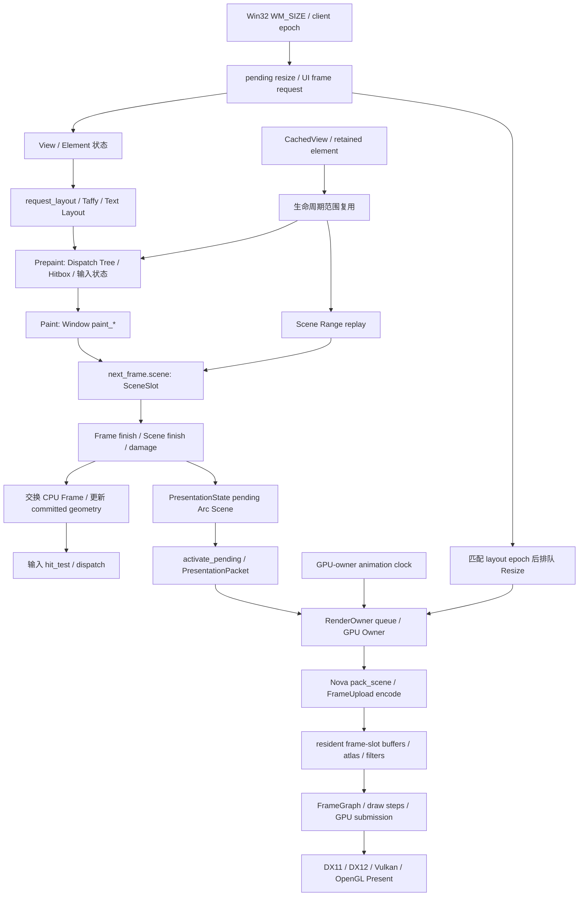

# GPUI P0 渲染依赖审计

> **历史审计快照，不是当前架构执行计划。** 当前唯一的 GPUI 统一合成重构状态源是 [GPUI_UNIFIED_COMPOSITOR_TODO.md](GPUI_UNIFIED_COMPOSITOR_TODO.md)。本审计中 RenderTree/RenderCommit 的旧目标、旧 HEAD、旧时间戳和文件位置只保留为历史证据；不得据此重新建立 RenderTree/Scene/RenderCommit/RenderPipeline 多层全窗口表示。维护者已允许破坏性删除旧 Scene 与冗余封装，但必须保留真正的绘制、GPU 和输入功能。

> 范围更新（2026-10-14）：按维护者最新要求，不再建立额外的完整 Render Tree。
> 本次新增的树、Commit 原型与接入代码已归档并撤回。以下依赖图保留为当前链路的
> 调查依据；旧方案的删除清单不再作为执行计划。后续优先检查 Element、CachedView、
> Retained Identity、布局缓存及局部绘制复用的计算、失效传播与尺寸/输入/呈现版本。
> 维护者进一步明确：Scene 的目标是删除。迁移时复用上述已有结构，将必要的图元
> 批处理、滤镜和上传职责接到现有缓存与后端，不额外维护一棵完整渲染树，也不通过
> 重命名容器保留全窗口 Scene 提交。Zed 的窗口事件/绘制同步可作为参考；上游当前
> 仍保留 `crates/gpui/src/scene.rs` 的 Scene、replay、finish 与批次迭代，不能将其
> 描述成已经删除 Scene 的实现。

审计日期：2026-10-14。事实基准为**本地 `master`**，HEAD：
`c406190fa9408544f6c5385aa68b6f0aba32afd8`。开始审计时工作区干净。
远程 HEAD 仅作对照，没有 fetch、pull、切换分支或修改渲染源码。

本报告完成任务书 P0 的七项调查及依赖图、删除清单。它不表示 P1–P9 已完成，
也不证明用户视频中的黑边、点击错位或关闭延迟已经解决。

## 1. 搜索范围与符号边界

对仓库执行 `rg -l -w Scene .`，审计前命中 108 个文本文件。
对 Rust 源文件执行精确符号搜索，得到 483 行匹配；其中 `crates/gpui`
为 380 行、64 个文件。进一步搜索 `Scene|scene_index|paint_operations|pack_scene`
覆盖 GPUI 的 96 个 Rust 文件，包含实现、测试及 benchmark 接入口。
这些是词法匹配数量，包含注释和字符串，不等于类型引用数量。

- `crates/gpui/src/scene/display_list.rs:19` 的 crate-private `Scene` 是本任务目标。
- `crates/gpui-3d/src/scene.rs:171` 的 public `Scene` 是独立 3D 领域类型；
  map viewer、skin pack 及其测试使用的是 `gpui_3d::Scene`，不在删除清单中。
- `src/ui/window/debug/view.rs:2503` 起包含 Scene 指标和标签，需随指标迁移更新。
- 文档中的 Scene 架构描述需要在新链路实际接入后更新，不能预先改成已实现。

## 2. 当前依赖图

CPU Frame 提交、GPU submission、submission fence 完成、原生 Present 返回及桌面
实际显示是不同事件。图中的 CPU 输入切换不由 GPU 已显示该帧来触发。

## 3. Frame 与 Scene 所有权

| 当前所有者 | 证据 | 迁移约束 |
| --- | --- | --- |
| `Frame` 同时拥有 Scene、dispatch tree、hitboxes、listeners、input handlers、focus、tab stops、element states | `window/frame.rs:214` | GPU 树与 UI 输入树应分离，保留输入生命周期与版本对应关系 |
| `SceneSlot` 内含 `Arc<Scene>`，唯一引用时复用 scratch；已共享时 clear 创建空 Scene，避免整表 COW | `window/frame.rs:181` | 删除 SceneSlot，但不能退化成跨线程共享可变树或每帧复制完整树 |
| `Scene` 保存全局 operation stream、各类图元数组、层栈、blur capture、prepared batches、revision | `scene/display_list.rs:19` | 拓扑、局部内容、排序、滤镜依赖需有新所有者 |
| `PresentationState` 保存 active/pending immutable snapshots | `window/state.rs:445, 494, 500, 545` | UI 生成与 compositor 应用分开；不能以 pending 激活宣称已呈现 |
| `PresentationPacket` 持有 `Arc<Scene>`、layout extent/epoch、动画、damage | `platform/frame.rs:1051` | 替换为独立 RenderCommit，保留 Send/Sync 与完整资源所有权 |

`window/draw.rs:239` 的 `finish_completed_draw` 完成 Scene、计算 damage、发布 pending，
随后在 `:290` 起更新 committed geometry 并交换 CPU Frame。
`window/draw.rs:780` 的 `present` 再激活 pending 并交给平台。
`platform/render_owner.rs:39` 的反馈有 `submitted`，没有对应 layout/presented epoch。
因此目前 committed geometry 的含义是 CPU 已提交，不能解释成 GPU 已显示。

## 4. Paint、CachedView、动画及 Blur

| 依赖 | 入口及事实 | 必须承接的职责 |
| --- | --- | --- |
| Element Paint | `element/lifecycle.rs:381, 698`；`window/paint.rs:137, 273` | 在稳定元素身份下更新局部内容，保持父子混合 painter order 与 deferred overlay 顺序 |
| CachedView | `element/cached_view.rs:22, 627, 788, 910` | 保留 layout/context/semantics/dependency 验证，将 Scene range 改为稳定 subtree/chunk 引用 |
| Prepaint reuse | `window/draw_reuse.rs:327` | hitboxes、dispatch subtree、tooltip、deferred draws、text layouts 等 UI 副作用不能随 Scene replay 一起删掉 |
| Paint reuse | `window/draw_reuse.rs:678` | listeners、handlers、cursor、window controls、tab stops、element-state accesses 和 text layouts 均有复用行为 |
| Div self/child split | `element/div/element.rs:158, 491`；`window/retained_identity.rs:85, 138` | 父自身绘制和 child 绘制有独立区间；迁移要支持 child 前后的父绘制内容 |
| 全局 finish | `scene/display_list.rs:1467, 1471, 1475` | 替换全局排序、batch 准备、revision 比较；不能只是给同一容器换名称 |
| Damage | `scene/display_list.rs:410, 604`；`window/draw.rs:251` | 删除、移动、clip/filter 改变需覆盖旧与新区域；未提交 damage 必须累积 |
| Element blur/composite | `window/paint.rs:167`；`window/composite_layer.rs:5` | 当前通过捕获子 Scene 实现，需迁移到显式 Filter/Composite 节点和资源依赖 |
| Blur 表示 | `scene/primitive.rs:46, 262`；`scene/display_list.rs:1015, 1029` | 删除 StartBlur/EndBlur 栈协议及嵌套 Arc Scene，保留滤镜、alpha、clip、嵌套 blur 能力 |
| 动画 | `animation/engine.rs:132`；`platform/frame.rs:1051`；`window/frame_lifecycle.rs:1036` | 稳定绑定、retarget、完成通知、damage 和 renderer-owned cadence 迁移到节点/合成器；视觉采样继续遵守单帧时钟 |

`reuse_paint` 的 Scene replay 只是其中一个步骤。新 RenderSubtree 不能作为 UI
listener、focus、IME 或 dispatch 数据的 GPU 容器。匿名身份、重复 key、重新挂载、
多呈现实例及 generation ABA 是 P1 的必要设计项；现有 `ReconcileKey` 和
`retained_identity_ambiguity` 可作为身份验证证据，不能当作所有情况已解决。

## 5. Nova 上传、GPU 驻留与提交

当前入口是 `NovaRenderer::draw_frame`（`platform/nova/renderer.rs:383`）调用
`pack_scene`（`renderer/retained_upload.rs:763`），再进入
`FrameUpload::encode`（`frame_upload/encode.rs:87, 169, 262`）。
encode 消费 Scene 的 prepared batches；缓存 key 包含 Scene revision、atlas generation、
尺寸、alpha 和 blur quality。命中时可复用 packed 数据并刷新紧凑动画值。

`FrameUpload`（`frame_upload/frame.rs:91`）是 CPU staging vectors，不是 GPU 驻留状态。
renderer 已持有 frame-slot buffers/resource sets、GPU atlas、path mask、filter targets、
retained upload signatures 和 draw-step cache（`renderer.rs:120–169`）。
P4 应将其缓存身份和上传单位迁移到节点/chunk generation，保留现有资源能力，
不能把已存在的资源驻留重复描述为本次新增成果。

`renderer/submission.rs:57, 123, 144` 控制安全 slot 选择和 submission poll；`:163` 起有
资源替换前的等待。`renderer/frame_graph.rs:46` 描述 persistent filter/path targets，
`renderer/present.rs:665` 构建当前 pass 图。新图需要以 dirty nodes/layers 和实际资源
依赖驱动，不能仅把完整 Scene 换成完整树再每帧重编码。

`render_owner/queue.rs:168` 起的 latest-wins Draw 替换可行的前提是新 packet 含完整
快照，并合并旧 damage。增量 Commit 不能照搬“删除旧 Draw，仅保留最新”的逻辑：
Create/Update/Remove、资源引用、base sequence、原子应用和 fence retirement 必须一起
处理，且不能跨 Resize/Call/Shutdown 等控制屏障合并。

关闭路径已有 Windows 异步 owner shutdown（`platform/render_owner.rs:473`），
owner 保留 native keep_alive；窗口资源释放在
`platform/nova/renderer/destroy.rs:16`，worker 在 `render_owner/worker.rs:97` 删除 entry。
这不证明用户报告的主/子窗口关闭速度或 GPU 关闭中安全性已通过实窗验证。

## 6. 四后端与其他平台

| 后端 | 当前源码证据 | 后续重构必须处理 |
| --- | --- | --- |
| DX11 | `gfx-dx11/src/surface.rs:197`：ClearState/Flush/ResizeBuffers；`:320` 起 draw/Present | backbuffer 引用、窗口覆盖、提交追踪及资源释放 |
| DX12 | `gfx-dx12/src/device.rs:674`：resize；`:1815` 起 deferred fence；`:2321` 起 Present | allocator/list/backbuffer 生命周期、fence retirement、DComp/opaque HWND 差异 |
| Vulkan | `gfx-vulkan/src/device.rs:545, 566`：resize 使用 device_wait_idle；`:2018` fence；`:2183` queue_present | 移除逐次 resize 的全设备等待，覆盖 WSI extent、layout、queue ownership 和在途资源 |
| OpenGL | `gfx-opengl/src/surface.rs:165`：新 color/FBO 后替换；`:227` swap_buffers；`device.rs:271, 363` GL fence | context thread affinity、FBO 初始化/覆盖、GL fence 退休 |

共同契约在 `gfx-core/src/backend.rs:93, 854, 976`，submission 状态在
`gfx-core/src/gfx_core.rs:261`。四后端共享 GPUI Nova 的 Scene/FrameUpload 上游，
但 resize、wait、present 的底层语义不同；相同现象不证明同一 GPU 瓶颈。

共享 API 删除还影响 Linux X11/Wayland 的 OwnedNovaRenderer
（`gpui/src/platform/linux/x11/window.rs:789`、`linux/wayland/window.rs:202`）、
Blade（`platform/blade/renderer.rs:759`）、macOS Metal
（`platform/mac/metal_renderer.rs:364`）及 status item（`platform/mac/status_item.rs:244`）。
这些消费者需要同步迁移，不能保留旧 Scene 兼容入口掩盖未完成迁移。

## 7. Windows Native Resize 与输入状态

1. `WM_SIZE` 在 subclass 中同步当前 HWND client geometry，调用
   `dispatch_native_resize_frame`（`platform/windows/window.rs:450`）。
2. `dispatch_native_resize_frame`（`:2067`）请求 UI commit 并直接调用
   `dispatch_pending_update_with_vsync`。通过 cadence/reentry 判断后可同步进入
   `invoke_request_frame`（`:2240`），所以不能称为完全异步 UI 调度。
3. `dispatch_pending_resize`（`:2271`）保存完整 `PendingWindowsResize`。
   `try_apply_queued_renderer_resize`（`:2280`）同时比较 epoch 和 extent，再排队 Resize。
4. epoch 经 `render_owner/queue.rs:24`、`worker.rs:332` 进入 Nova 的
   `DrawableSizeRequest`；`renderer/surface_lifecycle.rs:354` 不匹配时保留请求并拒绝应用。
   owner readiness 也传入 packet epoch（`worker.rs:457`）。
5. CursorMoved、MouseInput、MouseWheel、Touch 当前均使用 committed scale
   （`windows/platform.rs:1556, 1661, 1711, 1749`），不能继续沿用“Wheel/Touch 使用 live scale”的旧结论。
6. 输入 geometry 在 CPU Frame 完成时切换，owner 反馈没有相应 epoch；
   Native/Layout/Commit/Surface/Presented 的明确状态与确认规则仍是 P3/P7 的工作。

DX11/12 非 composition HWND swapchain 使用 `DXGI_SCALING_NONE`，composition 路径
使用 `STRETCH`（`gfx-dx11/src/surface.rs:104`、`gfx-dx12/src/device.rs:440, 632`）。
Nova 还有超额 drawable capacity 策略（`nova/backend.rs:308`、
`renderer/submission.rs:203`）。这些机制不等于旧有效内容已经持续覆盖扩大后的 client。
P7 需分别验证 opaque/composition、alpha、capacity、临时覆盖和真实新布局的切换。

**已确认的缺口**是同步 UI 构帧入口、提交/输入/呈现代次缺少完整对应反馈、
Vulkan resize 的 device-wide idle，以及 Scene 仍为完整提交边界。
**尚未确认**的是这些缺口与视频黑边、点击错位、复杂页面卡顿、主/子窗口关闭延迟
之间的具体运行时因果。CPU/GPU 总占用率和 slow_resize 日志不能单独定位瓶颈。

## 8. 删除与迁移清单

| 旧结构/范围 | 最终处理 | 删除前承接者 |
| --- | --- | --- |
| `scene/display_list.rs` 的全窗口 Scene、全局 paint_operations、revision、replay、finish | 删除 | Persistent RenderTree、局部 RenderChunk、增量 reconciliation/damage |
| `scene/batch.rs`、`prepared.rs` 的整 Scene batch 组织 | 替换 | chunk/layer 局部排序和稳定 GPU draw ranges |
| `scene/primitive.rs` 的 StartBlur/EndBlur、PaintBlur 子 Scene | 删除旧表示 | 显式 Filter/Composite 节点与资源依赖 |
| Quad/Shadow/Sprite/Path/Blur/Surface/RendererExtension 的绘制能力与公共样式 API | 迁移保留能力 | 独立 primitive/node/resource 模块；同步 canonical re-export |
| `scene/path.rs`、`path_builder.rs`、`transform.rs` 等公共/通用能力 | 迁移，不能直接删功能 | primitive/geometry/resource 所属模块 |
| `SceneSlot`、`Frame::scene`、`PaintIndex.scene_index` | 删除 | UI input frame 与持久渲染树分离；范围改为节点/内容引用 |
| retained_scene_segments/index、Div self_scene/child_scene_range、rebase_scene_range | 替换 | 稳定 subtree/chunk 身份、局部 painter order、版本验证 |
| `CachedView`/`draw_reuse` 的 Scene range replay | 删除绘制回放协议 | 直接保留 RenderSubtree；独立保留 UI 生命周期复用 |
| `PresentationSnapshot.scene`、`PresentationPacket.scene`、Scene 动画索引/边界扫描 | 替换 | RenderCommit、节点动画绑定、compositor 状态及显式代次 |
| RenderOwner 完整快照 latest-wins 逻辑 | 重写 Commit 合并与应用 | atomic operations、base sequence、资源引用与退休 |
| `pack_scene`、`FrameUpload::encode_scene`、Scene revision cache keys | 删除旧入口 | chunk generation / dirty buffer ranges / resident allocations |
| Nova filters、atlas、path mask、frame-slot buffers、submission fences | 保留并迁移身份/失效协议 | compositor GPU resource owner，不能为删 Scene 丢弃生命周期保证 |
| Blade、Metal、X11、Wayland、macOS status item 消费者 | 同步迁移 | 新提交/绘制输入，无旧 Scene adapter 最终分支 |
| Scene 专属诊断、窗口/缓存/GPU tests、benchmark.rs 与 benches | 改写或删除失效测试 | 新接口的局部更新、资源、输入、滤镜、动画、resize 验证 |
| 架构文档、性能文档及应用 debug Scene 标签 | 实现后同步更新 | 实际新链路及对应指标，不提前宣称完成 |

`gpui-3d::Scene`、业务模块、依赖版本、运行时配置不因词法命中自动进入删除范围。
`BackendSurface` 兼容 trait、未使用的 transient graph 枚举也不自动进入 P0 清理范围。

## 9. Zed GPUI 上游对照

本地 manifest 记录的 fork 来源为 `6805d952f9f3d702f760aa11b1547df8a625fa16`。
本次另行读取 Zed 官方仓库 `main` 的固定快照
`c403bc6af644cd0ab60c90045ac6dc3436218809`；没有把上游代码拉入本地 master。
该快照的 Windows 实现已经拆到 `crates/gpui_windows`，不能沿旧路径假设代码未变。

| 上游机制与证据 | 对本项目的作用和限制 |
| --- | --- |
| [events.rs](https://github.com/zed-industries/zed/blob/c403bc6af644cd0ab60c90045ac6dc3436218809/crates/gpui_windows/src/events.rs#L223)：WM_SIZE 更新逻辑尺寸、同步 renderer resize，再调用 resize callback；WM_PAINT 经 draw_window 请求 GPUI 帧 | 可参考 geometry 更新与绘制入口的职责分工。上游同步 GPU resize 不满足本任务的独立 compositor/非阻塞 resize 要求，不能整段照搬 |
| [DrawCoordinator](https://github.com/zed-industries/zed/blob/c403bc6af644cd0ab60c90045ac6dc3436218809/crates/gpui_windows/src/events.rs#L35)：平台共享跨窗口 drawing guard，RAII 退出；重入时验证 paint region 并延后到后续 vsync | 可参考跨窗口防重入、异常路径 guard 释放及延后请求不能丢失。本地 per-window guard 需在 P7 核对共享 App 借用边界 |
| [draw_window](https://github.com/zed-industries/zed/blob/c403bc6af644cd0ab60c90045ac6dc3436218809/crates/gpui_windows/src/events.rs#L1321)：取得 guard 后取出 request_frame callback，结束时恢复 callback、更新 IME 并 ValidateRect | 可参考 callback 所有权和 IME 更新顺序；不据此宣称本地输入与异步 GPU 呈现已同步 |
| [directx_renderer.rs](https://github.com/zed-industries/zed/blob/c403bc6af644cd0ab60c90045ac6dc3436218809/crates/gpui_windows/src/directx_renderer.rs#L485)：释放 backbuffer 引用后 ResizeBuffers；composition 为 STRETCH，HWND 为 NONE | 上游同样区分窗口类型，不能以“上游正常”证明切换所有 swapchain 为 STRETCH 即可解决黑边 |
| [scene.rs](https://github.com/zed-industries/zed/blob/c403bc6af644cd0ab60c90045ac6dc3436218809/crates/gpui/src/scene.rs#L41)：仍有 Scene、paint_operations、range replay、finish 排序 | 可参考绘制正确性细节；它没有提供本任务要求的完整 Persistent RenderTree/RenderCommit 替代实现 |

上游对照支持借鉴原生事件、防重入和资源引用处理；它没有给出本地四 Nova 后端黑边的
实机结论，也不改变本任务移除全窗口 Scene 的终态要求。

## 10. 验证与 P0 结论

- 实际执行：本地分支/HEAD/status 核对、上述 `rg` 精确与关联搜索、调用方和后端源码读取。
- 本次会话已执行四 Windows Nova 后端的编译基线：
  `cargo check --manifest-path crates/gpui/Cargo.toml --no-default-features --features windows-manifest,mimalloc-collect,nova-gfx-dx11,nova-gfx-dx12,nova-gfx-opengl,nova-gfx-vulkan`。
  输出 `Finished dev profile`，无编译错误；GPUI 有 54 条既有 warning，另有 DX11/OpenGL warning。
- P0 没有修改 Rust/Cargo/shader 源码，没有新增或运行测试，没有启动实窗，没有提交或推送。
- P0 七项审计、依赖图和删除清单完成。P1 的入口应是稳定节点身份、节点局部绘制内容、
  topology/order 与 generation；不能通过先包装完整 Scene 或仅重命名来建立迁移终态。
